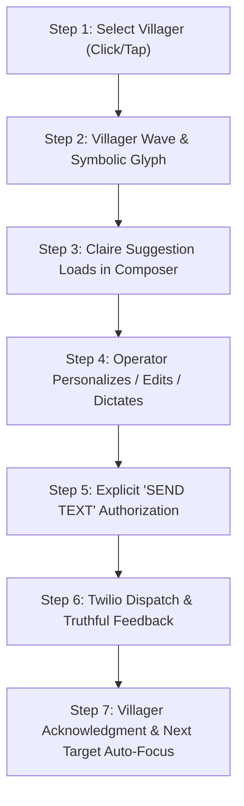

# INTERACTION SPECIFICATION — COZY VILLAGER OUTREACH
**Document:** `INTERACTION_SPEC.md`  
**Feature:** Lantern City Playable Customer Recovery  
**Authority Split:** Claire (Business Context & Drafts) • Daphne (Behavioral Entry Point) • Mitch (Playable Interaction)

---

## 1. Core 7-Step Interaction Loop



### Step 1: Select a Villager
- Operator clicks or taps any active villager (`slot_01` through `slot_08`).
- Selected villager enters **Attentive / Selected** animation state (`asset_05_animation_key_poses.png`, Pose 3).
- Subtle golden targeting ring illuminates on the ground underneath the character.
- The corresponding house receives a warm porch-light highlight.

### Step 2: Decorative Villager Expression
- A small illustrated speech bubble pops above the villager with a friendly glyph (e.g., heart, wave, sparkle).
- **Rule of World Truth:** This glyph is strictly decorative and ambient. It does *not* claim to be an incoming customer communication.

### Step 3: Operator Message Composer
- The right-hand drawer (desktop) or docked bottom sheet (mobile) animates into view.
- Real canonical recipient binding is displayed:
  - Customer First Name & Identifier (e.g., `Mei • Silver Lake Customer #1492`).
  - Outreach Eligibility badge (e.g., `Eligible Dormant Recovery`).
- Claire's personalized draft is pre-populated in the editable text container.
- Initial suggested text is derived from real order history (e.g., date of last order, service type), never fabricated relationships or unapproved discounts.

### Step 4: Personalization & Dictation
- Full keyboard text editing with real-time character counter (`128/160`).
- **[TALK TO TEXT]** Button:
  - Leverages Web Speech API (`webkitSpeechRecognition` / `SpeechRecognition`) where available.
  - Dictated speech appends smoothly to the active cursor position.
- Cancel / Escape / Dismiss closes the composer without saving or sending.

### Step 5: Send Authorization Boundary
- The operator must explicitly press the **[SEND TEXT]** button.
- Safety Rules:
  - Selection never triggers automated sending.
  - Decorative bubbles never trigger sending.
  - Double-clicks are debounced; duplicate requests return identical idempotency keys.
  - If phone number or marketing consent is missing, the button is disabled with an explanatory tooltip (`Consent Required`).

### Step 6: Dispatch & Truthful State Feedback
- Outbound SMS payload transmitted to backend endpoint (`/api/goldline/outreach/send-sms`).
- Provider states maintain truthful boundaries:
  - `Sending...`: Golden ascending sparkles on lantern.
  - `Twilio Accepted`: HTTP 200/201 from Twilio. Lantern displays solid brass checkmark.
  - `Delivered to Handset`: DLR webhook received from carrier.
  - `Incoming SMS`: Inbound message webhook received; turns cyan beacon on.
  - `Order Reactivated`: Confirmed new laundry order entered in database.

### Step 7: Transition to Next Target
- Once Twilio accepts the dispatch, the current villager transitions to **Send Acknowledgment** (`Pose 4`), raising their lantern.
- The composer auto-advances to the next incomplete villager in the group (`slot_n + 1`), maintaining fluid momentum.

---

## 2. Daphne Behavioral Tracking Telemetry

Events emitted to Daphne's epistemic store for intervention learning:

```typescript
export interface VillagerOutreachTelemetryEvent {
  missionId: string;
  territorySlug: 'silver-lake' | 'los-feliz' | 'hollywood' | string;
  customerId: string;
  slotIndex: number;
  eventType: 
    | 'mission_opened'
    | 'villager_selected'
    | 'draft_viewed'
    | 'draft_edited'
    | 'talk_to_text_used'
    | 'send_authorized'
    | 'twilio_accepted'
    | 'provider_failed'
    | 'session_closed';
  timestamp: string;
  metadata?: {
    charCountInitial?: number;
    charCountFinal?: number;
    wasEdited?: boolean;
    durationMs?: number;
  };
}
```

> **Ethical Boundary:** This data is used solely to evaluate whether cozy visual mechanics reduce initiation avoidance compared to traditional list views. Daphne does not make clinical psychological claims.
