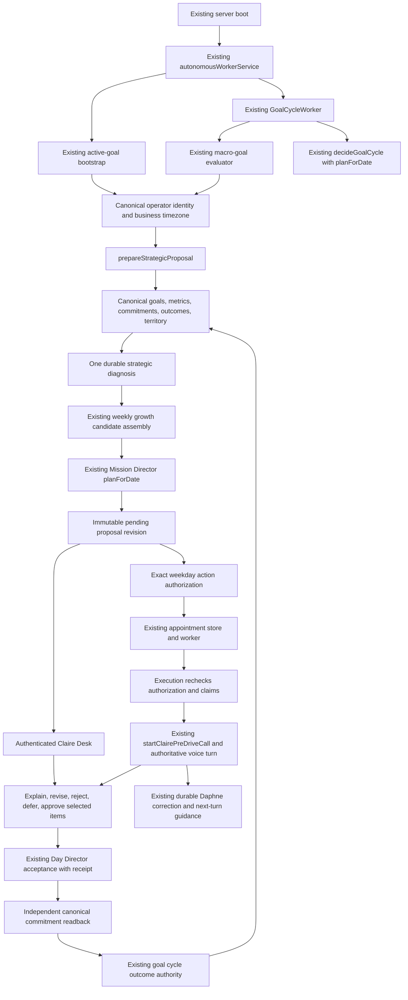

# Claire strategic preparation — engineering delivery report

**2026-10-13. Implemented and verified in an isolated integration branch; strategic quality certification and production acceptance remain incomplete.** Adam explicitly chose “Keep certification incomplete for now.” This report does not certify strategic competence, business ROI, or completion of every product acceptance gate.

“Verified” below means source inspection or a named executable check. Synthetic scenario results are labeled as such. An unknown or unperformed acceptance is not a passing gate.

## 1. Branch, commits, PR, and head

- Delivery branch: `codex/claire-strategic-production`.
- Base: `b2a8bc9adcf71183989343b4b8dfc06f543b2af3`, current main and independently reported Railway production commit at inspection.
- Implementation: `e575e83c` — autonomous preparation, exact approval, bounded delivery.
- Current-main reconciliation and final connected proof: `36c6ad75bbf66121f9eccfb54bd56ba23b724c33`.
- Domain ports and release-consumer migration correction: `8ff62f35`.
- Report/evidence commit: `6351d947`. Draft PR: [#575](https://github.com/adamwright83-blip/bldg-admin-api/pull/575). The final PR head is recorded in the delivery message; the PR is authoritative for later updates.
- Worktree: `/Users/adamwrightpfi/.codex/worktrees/claire-strategic-production/Cursor_bldg-admin-api`.

The initial checkout contained unrelated, uncommitted Daphne work on an older branch. That work was preserved. Only the strategic program's commit was transferred onto current main; foreign branch commits were excluded. The isolated delivery branch retains current main's identity admission, weekly appointment lineage, durable play/path stores, and turn cutover rules.

## 2. Exact changed files

The complete repository-relative manifest is [changed-files.txt](../../artifacts/claire-strategy/changed-files.txt), generated against the above main base. It includes the report and evidence files. It is the authoritative exact list; the architecture descriptions below group those files by purpose.

## 3. Actual connected runtime call graph

The following graph describes the implemented source path. The real MySQL journey exercises it with synthetic business records and controlled outbound provider transport. It does not establish that the candidate is serving production traffic.



**VERIFIED source anchors:** `server/_core/index.ts:918` starts the existing workers; `autonomousWorkerService.ts:469` prepares the active-cycle proposal; `decisionEngine.ts:524` calls `planForDate`; `operatorAppointmentExecution.ts:211` loads the stored proposal and `:228` calls `startClairePreDriveCall`; `strategicApproval.ts:171` fails mismatched canonical readback; `claireTwilio.ts:1105` captures the durable preference. Paths after the entrypoint are under `server/agents/persistentOperator/`, `server/strategy/`, and `server/claire/` respectively. **INFERRED:** the heuristic constraint is a plausible business explanation, not proven causality. **UNKNOWN:** uninspected production flag values and real customer strategic outcomes.

`server/_core/index.ts` already starts `startAutonomousPersistentOperatorWorkers`. Both existing bootstrap and active goal-cycle execution now prepare strategic proposals. `decisionEngine.ts` obtains `planForDate()` before selection needs an authoritative plan. No new cron, heartbeat, or scheduler was created.

Preparation reads current evidence first, refreshes diagnosis when semantic evidence changes, asks Mission Director for current/next-week business dates, and stores the exact selected items. A one-hour reuse bound does not suppress a changed outcome or changed business fact. Proposals expire after 24 hours. Failed call scheduling leaves preparation available in the app.

## 4. Reused and introduced components

Reused: Persistent Operator workers, leases, decision/outcome stores, canonical identity, appointment policy/store/execution, action policy, standing authorizations, StrategyEngine snapshots, canonical paid-order/revenue/goal readers, the existing Vertical Registry, territory scan records/provider provenance, weekly growth assembly, Mission Director, weekly mission sessions, authoritative Claire voice dispatch, Day Director acceptance and receipts, and Daphne preference capture/readback.

Introduced: shared strategic evidence/diagnosis/proposal types; a market-context adapter; doctrine validator; one diagnosis assembler and read-only evidence adapter; optional constrained quality-review adapter; immutable strategic stores; preparation and candidate adapters; exact revision response/approval handling; a narrow role-feedback authority veto; explicit weekday authorization contract/service; authenticated proposal and consent controls; a reproducible scenario evaluator and real MySQL journey.

The strategy adapter supplies evidence-linked candidate rationale. Mission Director's existing ranker still owns selection. Investigation work is penalized inside that ranker; a legitimate overdue obligation can remain primary. Unconfirmed recommendations are never substituted into approved-primary fields.

## 5. Ownership, persistence, and migration

| Authority | Owner and resulting behavior |
|---|---|
| Business truth | Existing canonical readers. New diagnosis records preserve evidence references and classifications; they do not replace financial ledgers. |
| Industry capabilities | Existing `defaultVerticalRegistry`, explicitly resolved tenant vertical. |
| Geography | Actual SaaS tenant locations/service radii, fallback saved wash-and-fold territory, and existing sourced territory scans. |
| Diagnosis | StrategyEngine's single assembly path. Heuristics identify a plausible constraint or recommend investigation. |
| Operational ranking | Existing Mission Director. Cross-replica persistence locks the tenant row and reads the exact persisted revision. |
| Pending work | Immutable strategic proposal and existing weekly session; no execution permission. |
| Commitments | Existing Day Director acceptance. Exact approved items, revision, actor, and lineage are independently read back. |
| Delivery | Existing Persistent Operator appointments plus exact standing authorization and execution-time recheck. |
| Operator adaptation | Existing Daphne durable observations/preferences; no authority to invent facts or approve work. |

Three new append-only MySQL tables: `strategic_diagnoses`, `strategic_planning_proposals`, `strategic_proposal_responses`. They require a real database in runtime; persistence failures do not fall back to a success-shaped in-memory record. Proposal row locking serializes acceptance, revision, rejection, and deferral. IDs/revisions support idempotency. Semantic readback uses deep JSON equality because MySQL may reorder object keys.

Schema extensions include tenant-selected strategy vertical, exact weekday authorization constraints, and the weekday strategic appointment kind. `drizzle/0128_claire_strategic_preparation.sql` records the new tables and guarded industry/authorization/appointment extensions; **actual production boot `scripts/migrate.mjs` also provisions and asserts the required tables/columns/enums**. Current main's territory-schema repair remains the owner of existing territory tables. Boot was exercised repeatedly on disposable MySQL 8, including a second idempotent boot. Numbered release replay also passes on a separate fresh MySQL database, including repeated replay from 0128. The formerly failing authoritative visit-route consumer passes unchanged. No production database was migrated by this task.

`presented` objectives now remain blocked recommendations; only accepted/in-progress work can project to ready. The legacy strategy mission sequencer returns pending approval rather than directly inserting Day Line work after a path choice. Choosing a strategy is not approval of its individual actions.

## 6. Doctrine sources, version, and checks

Doctrine version: **`2026-10-13.1`**. The repository stores original, concise paraphrases, not copied book passages. The sources describe credible methods; their inclusion does not prove business efficacy:

| Principle encoded | Primary source |
|---|---|
| Diagnose the pivotal challenge, choose coherent action | [Richard Rumelt](https://www.richardrumelt.com/articles) |
| Customer arena and way to win | [Roger Martin — Playing to Win](https://rogerlmartin.com/lets-read/playing-to-win) |
| Positioning, reinforcing activities, trade-offs | [Harvard Institute for Strategy and Competitiveness](https://www.isc.hbs.edu/strategy/Pages/strategy-explained.aspx) |
| Hypothesis and validated learning | [Eric Ries — Lean Startup principles](https://theleanstartup.com/principles) |
| Lead measures and review cadence | [FranklinCovey — 4 Disciplines](https://www.franklincovey.com/courses/the-4-disciplines/) |
| Bounded tests of consequential uncertainty | [Strategyzer — Testing Business Ideas](https://www.strategyzer.com/library/testing-business-ideas-book-summary) |

Executable checks require a diagnosis, supported doctrine version, valid same-tenant/nonfuture evidence references, at least two compared options, an eligible selected approach, economics/cost/effort/time/capacity/risk/reversibility, customer/industry/local-fit disclosure, uncertainty, measurable action completion, lead/result measures, and a revision trigger. Invalid territory/prospect provenance fails local claims. Estimated, stale, partial, future, or cross-tenant financial values cannot become verified bottleneck inputs.

The optional model reviewer uses the existing model integration, supplied evidence IDs, and constrained acceptable/revise judgment. Invented citations, malformed output, and provider failure cannot produce a pass. It can veto; it cannot introduce facts, actions, or ranking authority. Requires `CLAIRE_STRATEGY_QUALITY_REVIEW_ENABLED=1` plus the existing provider credential. Its unavailable/default state is disclosed, not graded as passed. Four deterministic adapter contracts pass. **Live model judgment was not performed.**

## 7. Market resolution and evidence provenance

Market resolution loads all actual configured tenant locations and service radii first; fallback is the tenant's saved territory profile. Missing/invalid coordinates or radius remain unavailable. Software can be online without a physical service area. There is no Los Angeles fallback.

Existing recent territory scan observations preserve provider/source, capture time, coordinates, evidence classification, and uncertainty. The adapter rechecks membership in a current valid territory using existing distance calculations, deduplicates observations, and excludes future, stale, and out-of-radius observations. Public prospect presence is **not verified demand**, annual account estimates are not revenue, and neither is contribution profit.

The existing Places discovery path remains available to populate scans. This change reads its persisted results rather than adding another provider integration. No fresh external prospect research was performed during acceptance. Customer geography, route density, demographics, seasonality, local rules, buyer motivation, competitor differentiation, and demand remain unknown when authoritative evidence is absent. Their absence can require investigation; the system does not manufacture them.

## 8. Industry capabilities and limitations

Laundry uses existing paid-order/net-sales/new-active-customer/commercial readers and a mature repeat-cohort reader. AOV requires compatible periods and actual order counts. Revenue uses canonical coverage metadata; recorded cents from an incomplete book do not masquerade as whole-business revenue. Retention uses a mature cohort and adequate sample, avoiding premature classification of new customers as lost. Configured capacity is operator input, not an inferred measurement.

Laundry doctrine separates sales from processing/delivery costs and recognizes route/capacity constraints. **Pounds processed, variable cost, contribution margin, cash, and route economics do not acquire fictional readers.** Those unknowns constrain recommendations.

Software has a distinct module and activation/subscription-renewal vocabulary. Its currently unsupported canonical metric catalog is explicit; absent supported data it produces universal bounded investigation rather than laundry operations. Generic/unsupported businesses receive the same honest fallback. Tenant vertical is explicitly configurable in the authenticated app, with saved laundry configuration as the supported fallback. There is no `registry.list()[0]` inference.

This establishes industry isolation, not broad specialized strategic expertise for every industry.

## 9. Geography contamination repair

Actual `generateCandidatePlays()` resolves tenant vertical and market, separates reusable tactics from geography, and persists through current main's authoritative durable play store. Local tactics require valid tenant territory. IDs include tenant, vertical/template, and resolved geographic/configuration inputs. Loading a missing/cross-tenant play fails; no synthetic fallback grants a path. Historical snapshot schema versions are excluded from current reads.

The real MySQL journey generated and reloaded six Iowa-scoped plays and rejected cross-tenant access. Unit/scenario tests compare identical laundry economics in Los Angeles and Iowa; each receives its actual market labels without the other tenant's locations. Identical economics may correctly select the same business mechanism. A different city alone is not evidence for a different diagnosis.

`geographyRemediation.ts` idempotently invalidates unaccepted legacy candidate/offered plays with ungrounded template geography, records the reason and original geography, and preserves chosen/active/approved history as historical, unverified local claims. MySQL proof inserted only synthetic contaminated history: `legacy-candidate-4794e64a05` was invalidated; `legacy-active-4794e64a05` remained intact. Repetition made no further changes. No production historical business records were inspected or rewritten; tenant-scoped remediation runs through preparation when the candidate is deployed.

## 10. Actual generated diagnosis examples

The following are generated **fixture examples**, not measured customer businesses:

| Fixture | Plausible constraint | Generated selected approach |
|---|---|---|
| Strong mature repeat behavior, insufficient qualified demand | Acquisition | Test a qualified customer segment within the operating market |
| Adequate acquisition, weak mature repeat cohort | Retention | Investigate first-to-second-purchase barriers |
| Negative contribution per order | Contribution economics | Audit price and variable cost on a bounded order sample |
| No remaining fulfillable capacity | Capacity | Audit the fulfillment bottleneck and recover usable capacity |
| Sparse/stale evidence or unsupported industry | Investigation | Audit missing business drivers and customer evidence |
| Software retention facts | Retention | Investigate activation and subscription renewal barriers |
| Linked contradictory experiment outcome | Investigation/revision | Review the contradicted strategic hypothesis and compare a different mechanism |

The real MySQL journey begins with synthetic Iowa configuration and sparse canonical business records. Canonical readers correctly report limitations; the resulting work is investigation, not fabricated measured profitability or demand. This is a meaningful missing-data journey, not positive proof of real customer strategic competence.

## 11. Evidence of recommendation changes

Economics/capacity/retention inputs produce the different drivers/actions above. Five supported driver paths use explicit heuristics (negative contribution, cash runway under four weeks, capacity at/below zero, weak mature repeat behavior, strong repeat behavior with a qualified-demand gap). Evidence must be fresh (at most seven days), appropriately classified, and have exact/complete coverage. The thresholds are triage heuristics, not validated causal models. Conversion, price elasticity, differentiation, frequency, and market-selection problems can remain an investigation until sufficient evidence exists.

Geography changes resolved territory and admissible local observations; an attractive out-of-radius prospect is withheld. Industry changes vocabulary and admissible readers; software receives no wash-and-fold/route actions. Existing obligations remain under Mission Director's protection.

Actual MySQL proof records an operator-attested operational result `hypothesis_contradicted` through existing goal-cycle outcome authority, linked through the originating diagnosis objective. The next existing worker cycle changes diagnosis from `diagnosis_2bd460dc85073f55b92809297feedffd2b55f384` to `diagnosis_c4af121fecd8b9a312546f438819b8aba9079a9e` and selects the different-mechanism review above. Action completion alone is inconclusive, not business success. This proves connected adaptation to a persisted synthetic outcome; it does not establish verified real financial impact or superior causal inference.

## 12. Authorization, revocation, and no-permission behavior

The authenticated app grants exact action **`claire.strategic_planning.call`**, separate from Sunday permission. Grants bind tenant, canonical operator, operator user, call channel, weekdays 1–5, local start/end, business timezone, daily limit 1–3, authenticated consent source, and revocation. The UI initially selects no weekdays and defaults to one call per day. Granting requires a deliberate authenticated action. Preference/history/ownership alone never grant this permission.

Scheduling and execution both validate the grant. Execution locks and rechecks it, fences appointment claims, and counts dispatches across authorization revisions on the business date. Scheduling is one appointment per business date, within the permitted upper bound. A previously rejected/deferred or fully approved proposal is not repeatedly offered as pending work.

Real MySQL proof: preparation succeeds without consent and outbound calls remain **0**; a controlled test grant admits **1** provider invocation; revocation prevents a later dispatch and the count remains 1. Existing appointment machinery is reused. The only mocked boundary is outbound transport, which rejects any number other than the reserved test pair `+15555550111` / `+15555550112`. No real operator number was called or granted a new production consent by this task.

## 13. Approval and independent canonical readback

Weekly initialization carries the smallest `pendingRecommendation` with exact proposal ID/revision/opening. Approved primary fields stay unpopulated. App and voice load stored state, including current main's authenticated scope/admission and appointment/source lineage.

Controls support explaining evidence/options, approving all or selected items, revising an item into a new immutable proposal revision, rejecting, and deferring. Responses are durable. Superseded revisions cannot be approved. Partial approval preserves the conversation and remaining items. Reject/defer do not create work.

Approval requires authenticated owner/admin/operator scope, exact nonexpired revision, and nonempty bounded item scope. Existing Day Director acceptance returns a receipt; independent reads verify tenant/actor, business date, title, source text, idempotency key, and immutable proposal/revision/item/response lineage. Strategic supporting work does not displace a protected primary. Same-content retries preserve first approval lineage and lifecycle instead of rewriting them. A presented objective becomes accepted only after canonical verification. Failed save/readback cannot generate “added” speech.

Real proof accepted revised proposal `proposal_0c7d1a38fcf8b5a8ab07e729d674ea1908def253`, revision `0c7d1a38fcf8b5a8ab07e729d674ea1908def25382e865cb1206d39f1e708a30`, creating canonical commitment `1321d5a8-c775-45d9-85df-a25f47efb864`. Voice/app retry remained one commitment. A separate selected-item test approved item 1 of 2 and left item 2 uncommitted. Full evidence is [mysql-journey.json](../../artifacts/claire-strategy/mysql-journey.json).

## 14. October 13 regression results

| Failure pattern | Correction and verification |
|---|---|
| Brain V2 briefing grant bound to ordinary pending proposal | Only actual pending-briefing authority may mint/use that grant. Mismatch fails before writer invocation. |
| Day Line grant missing bounded work scope | Nonempty bounded title scope required; empty scope fails closed. “I also need to call Dana Tuesday” remains supported work intent. |
| Claire role feedback interpreted as mutation | Narrow role-feedback veto in executive/legacy/Brain V3 paths; live V2 defers this feedback to durable Daphne/turn handling. No Day Line grant. |
| Repeated questions about already prepared work | Weekly/voice session opens with the exact stored recommendation and retains revision rather than restarting an interview. Missing information is disclosed. |
| Claim of adding without canonical evidence | Receipt plus independent commitment readback required; failed/unverified writes do not support success speech. |
| Correction disappears by next interaction | Existing Daphne immutable observation/preference capture reads back `proactive_initiative=high`; actual next guidance reflects it. Existing tenant/global Daphne flags are respected. |

The current-main regression suite passes, including existing production-call replay and pending-action relationship behavior. Five final routing suites pass **78 tests** after the last cutover change. The connected MySQL journey proves durable correction and next-interaction guidance, independent of a history that did not exist initially. This does not claim every possible natural-language paraphrase or real acoustic call has been certified.

## 15. Strategic evaluation and failures

Fourteen deterministic scenarios pass with **no reported deterministic failures**: Los Angeles laundry, identical Iowa laundry, same-geography software, acquisition bottleneck, retention bottleneck, unprofitable growth, exhausted capacity, sparse data, stale data, outside territory, competing commitments, contradicted outcome, unsupported industry, and poor-margin segment. Additional contracts reject invented citations, cross-tenant/future/stale/estimated facts, invalid radii, inappropriate industry readers, revoked/Sunday-only weekday permission, and unsafe model output. The connected journey also tests duplicate planning across independent processes and preserved contaminated history.

The evaluator uses the existing Mission Director ranker as a controlled task-ranking baseline, supplied with one acquisition candidate. This is not a replay of the full production candidate set, and it cannot establish superiority over the current production system. Both outputs use a common presentation format. The A/B packet removes internal IDs/schema/model labels and randomizes allocation. Different completeness may still reveal the treatment; rigorous blinding has not been independently assessed. [blinded-review.json](../../artifacts/claire-strategy/blinded-review.json) is the review packet; [review-key.json](../../artifacts/claire-strategy/review-key.json) is separate and must be withheld until judgment is recorded. Criteria include diagnosis, economics, industry/geography, alternatives, evidence, coherence, feasibility, measurability, adaptation, and disqualifying errors.

**Independent blinded human review is pending, per Adam's instruction. No strategic-quality advantage is certified.** Structural tests and a more detailed narrative are insufficient proof. All scenarios are original synthetic fixtures; there is no historical replay claiming concealed future outcomes, no real-business ROI study, and no numerical human score. The principal weaknesses are heuristic constraint selection, incomplete economic/customer/local readers, mostly bounded audits, often withheld second options, and unperformed live model judgment. [stress-results.json](../../artifacts/claire-strategy/stress-results.json) explicitly records `fixtureOnly=true`, `strategicQualityCertified=false`, `humanReview=pending`.

## 16. Database, voice, build, and test results

| Check | Result and scope |
|---|---|
| TypeScript `npm run check` | Passed on current-main integration |
| `npm run build` | Passed; ordinary bundle-size warnings remain |
| Strategy/Mission Director/Claire/objective/Daphne focused regressions | 82 files, **900 passed**, 1 skipped real-DB test run separately |
| All Persistent Operator unit suites | 31 files, **223 passed**; includes 6 objective tests already counted above |
| Final authority-routing regression rerun | 5 files, **78 passed**, overlaps the focused suite |
| Real MySQL connected journey | 1 test passed; actual persistence/workers/voice contracts with controlled phone transport |
| Production boot migration and repeated boot | Passed on disposable MySQL 8 |
| Strategic scenario evaluator | 14 scenarios, no deterministic failures; human review pending |
| Domain-port and weekly/strategy follow-up | 14 files, **121 passed**, overlaps prior targeted suites |
| Numbered release replay and authoritative visit-route consumer | Fresh replay and repeated 0128 replay passed; unchanged real-DB route test passed |
| Nomenclature, tenant-default, vertical-dependency, domain-boundary guards | Passed on corrected committed diff; domain-boundary checker self-tests 11 passed |
| `git diff --check` | Passed |

The final real journey additionally verifies the app-facing domain read ports: industry configuration readback, grant/revoke consent visibility, accepted-item canonical status, rejection of tampered commitment source text, and cross-tenant proposal refusal. Claire’s router imports these services instead of the raw schema.

The real journey starts the existing workers with no authoritative plan, resolves canonical identity/timezone/tenant market/industry, prepares and persists evidence-linked diagnosis, produces Mission Director plans, obtains `MISSION_DIRECTOR_PRIMARY`, stores proposal, verifies no-consent behavior, grants test authorization, dispatches existing appointment and exact voice opening, revises/approves, reads canonical commitment back, retries without duplication, records contradictory outcome, and observes changed next diagnosis. Explain/reject/defer/selected approval and Daphne next guidance are separately asserted within that journey.

Four same-process planner calls return one plan ID. Two independent Node processes against MySQL return the same authoritative plan ID/revision (`46574236-986a-49cd-9bb8-589387fc16a6`, revision 3). Durable Iowa play reload and geography remediation also use the database. Phone transport is controlled; the rest is production-equivalent contracts, not in-memory substitutes. Synthetic identities/data are labeled `testOnly` throughout.

Reproduction:

```sh
npm run check
npm run build
npx vitest run server/strategy server/planning/missionDirector server/agents/persistentOperator server/claire/brain server/claire/weeklyMission server/claire/turn server/agents/daphne/explicitPreferenceCorrection.test.ts
node --import tsx scripts/evaluate-claire-strategy.ts
# Set DATABASE_URL to a disposable MySQL 8 database; never a production DB.
node scripts/migrate.mjs
node scripts/migrate.mjs
# Use the controlled test environment in the committed workflow.
npx vitest run --config vitest.integration.config.ts server/strategy/strategicJourney.mysql.integration.test.ts
```

`.github/workflows/claire-strategic-preparation.yml` repeats typecheck, all targeted suites including all Persistent Operator suites, production boot twice, controlled MySQL journey, and evaluator; it uploads the evidence. CI status is recorded on the PR. The weekday journey deliberately skips on a Chicago weekend instead of widening consent to make tests pass; a skipped run supplies no voice evidence. This Tuesday local run executed and passed.

## 17. Production status and unperformed acceptance

Railway's authenticated deployment listing reports service `bldg-admin-api` (`9d63863a-2626-47a0-bd65-c3ba8db54258`) in `supportive-creation` production (`330bff45-7d21-4cdf-be04-b38cea76fcfb`) running successful deployment `8197936f-fae1-40d3-8501-1a22de6356ea`, commit `b2a8bc9adcf71183989343b4b8dfc06f543b2af3`, updated `2026-10-13T15:32:29.049Z`. This is an infrastructure status read, not a smoke test of every production behavior. The candidate branch is **not deployed or merged** by this task.

Deployment prerequisites: run the actual boot migrations; keep existing canonical data/identity and configured business timezone available; explicitly configure supported vertical/territory; enable the existing workers with `DATABASE_URL` (workers disable on missing DB or `AUTONOMOUS_WORKERS_ENABLED=0/false`); use existing authorized phone/voice credentials and entitlement policy; obtain a real exact weekday grant before any real strategic outbound call. Daphne continuity uses `DAPHNE_V2_CLAIRE_ENABLED` or `DAPHNE_V2_CLAIRE_TENANTS`; Brain V2 uses existing `CLAIRE_BRAIN_V2_LIVE`, with strategic sessions handled by the existing weekly/authoritative voice path. Optional model review requires its own flag and provider credential. Production values of those flags were not retrieved; no secrets were exported.

Unperformed: production migration/deploy/rollback drill, authenticated browser interaction acceptance, live provider/model strategic judgment, actual customer financial/outcome validation, independent human certification, and an explicitly authorized real phone conversation. No real-call authorization was supplied. Controlled testing does not substitute for these gates. The PR remains draft for review with those boundaries visible. Initial CI caught a missing historical-name annotation, a new Claire raw-schema coupling, and a numbered-release schema gap. Those were corrected without weakening checks; final CI status remains authoritative on the PR.

## 18. Acceptance gates and remaining limitations

| Gate | Status |
|---|---|
| 1 Autonomous preparation | Verified in actual existing worker + real MySQL contracts on synthetic tenant |
| 2 Strategic reasoning | **Incomplete certification** — implemented heuristic diagnosis/alternatives; independent quality review pending |
| 3 Universal doctrine | Versioned executable checks verified; live judgment unperformed |
| 4 Local accuracy | Actual tenant resolution/persisted provider evidence verified; absent research remains unknown |
| 5 Industry isolation | Verified; software/generic capability limits explicit |
| 6 Economic integrity | Verified classification/coverage/unknown handling; missing cost/cash readers limit positive economic recommendations |
| 7 Proposal delivery | Controlled authorized voice verified; **live external acceptance incomplete** |
| 8 Conversation integrity | Stored-revision controls and durable correction verified; authenticated browser/live acoustics unperformed |
| 9 Execution authority | Exact approval and independent canonical readback verified in MySQL |
| 10 Learning | Actual persisted synthetic contradictory outcome changes next cycle; real business learning unverified |
| 11 October 13 regressions | Verified named authority/role/readback/continuity contracts and replay suites |
| 12 Stress evaluation | Deterministic 14 cases verified; **human evaluation incomplete** |
| 13 Persistence | Real MySQL journey and independent-process idempotency verified |
| 14 Production readiness | **Incomplete** — build/migration/flags documented; candidate deployment and live acceptance unperformed |

The system currently favors bounded investigation where truthful evidence is insufficient. This is safer than unsupported claims but falls short of the full product ambition of broadly competent autonomous strategic advice. Completing the human review, improving unsupported canonical evidence readers, and validating on actual businesses are material remaining work. No gate is redefined to treat synthetic tests or a draft PR as complete production acceptance.
